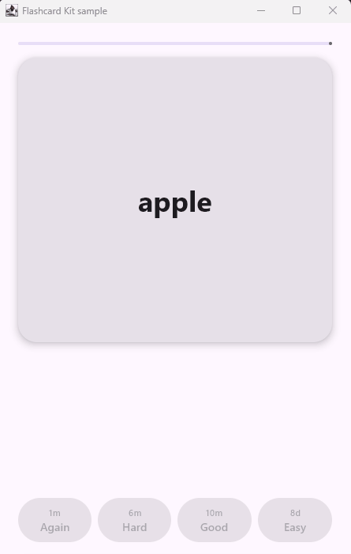

# Engram 🧠

**Spaced repetition (FSRS-6) and flashcard UI for Compose Multiplatform.** Build an Anki-style study screen for Android, iOS, desktop and web in about 20 lines of code.

> *Engram*: the physical trace a memory leaves in the brain. This library helps your users build them.

<p align="center">
  
</p>

- 🧠 **FSRS-6 scheduler**: the modern algorithm built into Anki, written in pure Kotlin and checked against the official reference implementation
- 🃏 **Flip card**: a 3D card that turns over to show the answer
- 👆 **Swipe to rate**: swipe right for Good, left for Again, up for Easy
- 🔘 **Rating buttons**: Again / Hard / Good / Easy, each labelled with when the card will come back (`1m · 6m · 10m · 8d`)
- 📋 **Study session**: queue, re-learning steps, progress and persistence callbacks are handled for you
- 🧩 **Use the parts you need**: `engram-core` has no Compose dependency, so you can use the scheduler on a server or in a ViewModel as well

| Platform | engram-core | engram-compose |
|---|---|---|
| Android | ✅ | ✅ |
| iOS | ✅ | ✅ |
| Desktop (JVM) | ✅ | ✅ |
| Web (Wasm / JS) | ✅ | ✅ |

## Quick start

```kotlin
data class Word(val english: String, val turkish: String, val card: Card)

@Composable
fun StudyScreen(words: List<Word>, repository: WordRepository) {
    val session = rememberStudySessionState(
        items = words,
        cardOf = { it.card },
        withCard = { word, card -> word.copy(card = card) },
        onReviewed = { word, result -> repository.save(word) }, // persist the new schedule
    )

    StudySession(
        state = session,
        front = { Text(it.english, style = MaterialTheme.typography.displaySmall) },
        back = { Text(it.turkish) },
        onFinished = { Text("All done for today 🎉") },
    )
}
```

New items start with `Card.new(id = "apple", now = Clock.System.now())`.

## Use only the scheduler

```kotlin
val scheduler = Scheduler(SchedulerConfig(desiredRetention = 0.9))

var card = Card.new("apple", Clock.System.now())
card = scheduler.review(card, Rating.Good).card

scheduler.preview(card)         // what each of the 4 ratings would do
scheduler.retrievability(card)  // chance (0–1) that the learner still remembers it
```

`Card` is a plain immutable data class. Store its fields (`due`, `stability`, `difficulty`, `state`, …) in Room, SQLDelight or wherever you keep your content.

## Use the components on their own

```kotlin
FlipCard(flipped = flipped, onClick = { flipped = !flipped }, front = { … }, back = { … })

SwipeableCard(onSwiped = { rating -> … }, enabled = flipped) { /* any content */ }

RatingBar(onRate = { rating -> … }, intervals = session.intervals)
RatingBar(onRate = …, ratings = listOf(Rating.Again, Rating.Good)) // two-button mode
```

## Why FSRS?

FSRS (Free Spaced Repetition Scheduler) predicts when you are about to forget a card and schedules it just before that. [Benchmarks](https://github.com/open-spaced-repetition/srs-benchmark) show that it predicts forgetting more accurately than the classic SM-2 algorithm, so learners need fewer reviews for the same retention. Anki ships it as a built-in option. Until now there was no maintained, tested Kotlin Multiplatform implementation.

This scheduler is a port of [py-fsrs](https://github.com/open-spaced-repetition/py-fsrs) and is tested against values produced by py-fsrs 6.3.2. One small difference: interval fuzz is seeded by the card's id and review count, so the interval shown on a button is always the one you get when you press it.

## Run the sample

```bash
./gradlew :sample:run
```

## Roadmap

- [ ] Maven Central release
- [ ] Android and iOS sample apps
- [ ] Statistics helpers (forecast, retention, heatmap)
- [ ] Type-in-the-answer and multiple-choice cards
- [ ] Optional FSRS parameter optimizer

Contributions and ideas are welcome. Please open an issue.

## License

MIT. The FSRS algorithm and default parameters come from the [open-spaced-repetition](https://github.com/open-spaced-repetition) project (MIT).
